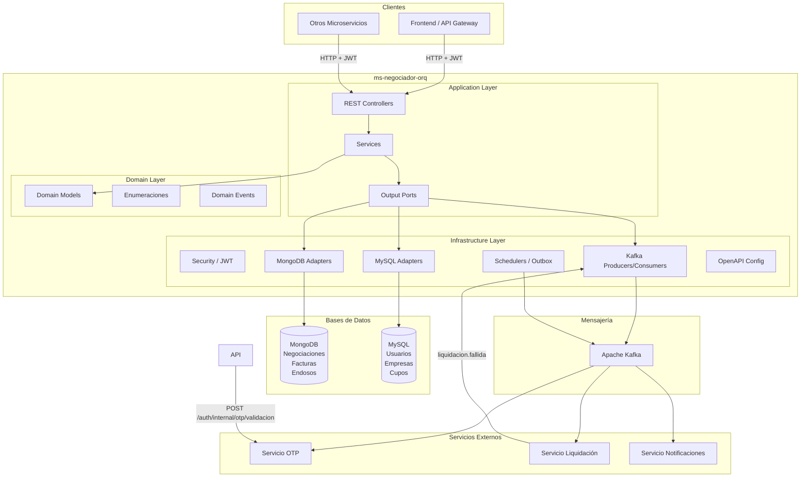
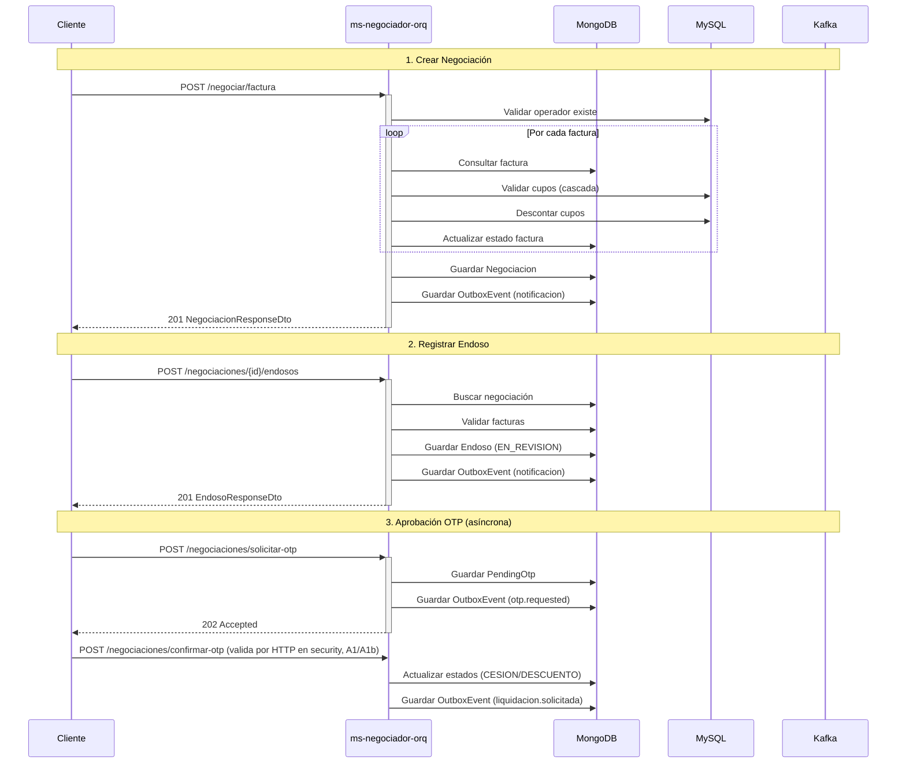
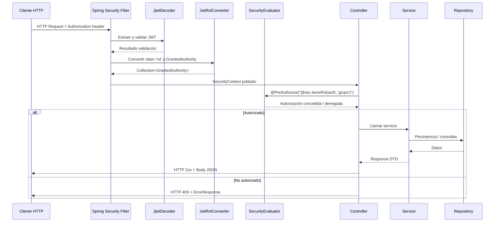
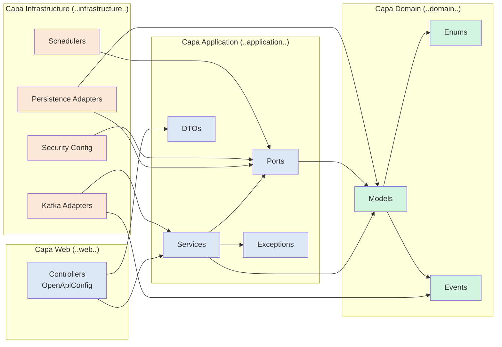

# ms-negociador-orq

Microservicio orquestador de flujos de negociación de facturas para operaciones de **Factoring** y **Confirming**.

---

## Tabla de Contenidos

1. [Descripción General](#1-descripción-general)
2. [Tecnologías](#2-tecnologías)
3. [Requisitos Previos](#3-requisitos-previos)
4. [Configuración](#4-configuración)
5. [Ejecución Local](#5-ejecución-local)
6. [Swagger / OpenAPI](#6-swagger--openapi)
7. [Endpoints](#7-endpoints)
8. [Reglas de Negocio](#8-reglas-de-negocio)
9. [Modelo de Datos](#9-modelo-de-datos)
10. [Seguridad](#10-seguridad)
11. [Observabilidad](#11-observabilidad)
12. [Pruebas](#12-pruebas)
13. [Estructura del Proyecto](#13-estructura-del-proyecto)
14. [Diagramas](#14-diagramas)
15. [Ambientes](#15-ambientes)
16. [Troubleshooting](#16-troubleshooting)
17. [Consideraciones Técnicas](#17-consideraciones-técnicas)

---

## 1. Descripción General

### Objetivo del Microservicio

`ms-negociador-orq` es el orquestador central de los flujos financieros de negociación de facturas. Su función es coordinar la validación, creación, endoso y aprobación de operaciones de **Factoring** (anticipo de facturas a proveedores) y **Confirming** (pago anticipado a proveedores por cuenta de pagadores), garantizando la integridad de cupos, el cumplimiento de reglas de negocio y la trazabilidad de cada operación.

### Problema de Negocio que Resuelve

En las cadenas de financiamiento de facturas intervienen múltiples actores (empresas, operadores, proveedores, pagadores, fondeadores) con cupos independientes y reglas de operación distintas según el tipo de producto financiero. Sin un orquestador, la validación de cupos en cascada, la gestión de estados de las facturas y la coordinación de aprobaciones con OTP serían responsabilidad de múltiples servicios sin garantía de consistencia. Este microservicio centraliza toda esa lógica.

### Alcance Funcional

| Funcionalidad | Descripción |
|---|---|
| Creación de negociaciones | Procesa lotes de facturas con validación de cupos en cascada |
| Registro de endosos | Genera documentos HTML de endoso de descuento |
| Aprobación con OTP | Flujo asíncrono de validación OTP via Kafka |
| Validación de vencimiento | Consulta el estado de vigencia de una factura |
| Reversión de cupos | Restaura cupos cuando una liquidación falla |
| Notificaciones | Publica eventos de email para cada transición |

### Arquitectura Utilizada

El microservicio implementa **Arquitectura Hexagonal (Ports & Adapters)** en combinación con principios de **Clean Architecture**:

- **Domain**: Modelos de negocio puros, enumeraciones y eventos de dominio. Sin dependencias de frameworks.
- **Application**: Servicios de aplicación, DTOs, puertos de salida (interfaces), controladores REST y excepciones de dominio.
- **Infrastructure**: Adaptadores de persistencia (MongoDB, MySQL/JPA), productores/consumidores Kafka, configuración de seguridad y configuración OpenAPI.

La comunicación asíncrona con otros microservicios se realiza mediante **Apache Kafka** con el patrón **Outbox** para garantizar la entrega de eventos.

---

## 2. Tecnologías

| Categoría | Tecnología | Versión |
|---|---|---|
| Lenguaje | Java | 17 |
| Framework | Spring Boot | 3.5.4 |
| Gestión de dependencias | io.spring.dependency-management | 1.1.7 |
| Build | Gradle | 8.10 |
| Persistencia documental | MongoDB (Spring Data) | Spring Boot 3.5.4 managed |
| Persistencia relacional | MySQL + Spring Data JPA | Connector 8.3.0 |
| Mensajería | Apache Kafka (Spring Kafka) | Spring Boot 3.5.4 managed |
| Seguridad | Spring Security 6 + OAuth2 Resource Server | Spring Boot 3.5.4 managed |
| JWT | jjwt-api | 0.12.6 |
| Documentación API | springdoc-openapi-starter-webmvc-ui | 2.5.0 |
| Generación de PDF | openhtmltopdf-pdfbox | 1.0.10 |
| Reducción boilerplate | Lombok | Spring Boot 3.5.4 managed |
| Pruebas unitarias | JUnit 5 + Mockito | Spring Boot 3.5.4 managed |
| Pruebas de aceptación | Karate | 1.4.0 |
| Pruebas de arquitectura | ArchUnit | 1.3.0 |
| Pruebas de rendimiento | Apache JMeter | 5.6.3 (externo) |
| Cobertura | JaCoCo | 0.8.13 |
| Análisis estático | Checkstyle | 10.17.0 |
| Análisis estático | PMD | 7.3.0 |
| Análisis estático | SpotBugs | 4.8.6 |
| Calidad de código | SonarQube | Plugin Gradle `org.sonarqube` 5.1.0.4882 (servidor: pendiente por definir) |

---

## 3. Requisitos Previos

### Java

- **JDK 17** o superior. Se recomienda [Eclipse Temurin 17](https://adoptium.net/).

```bash
java -version
# java version "17.x.x"
```

### Gradle

- **Gradle 8.10** (incluido via Gradle Wrapper, no requiere instalación manual).

```bash
./gradlew --version
```

### Bases de Datos

| Base de Datos | Versión Mínima | Uso |
|---|---|---|
| MongoDB | 6.x | Negociaciones, facturas, endosos, OTP, outbox |
| MySQL | 8.0 | Usuarios, empresas, cupos |

### Mensajería

- **Apache Kafka** 3.x con los siguientes topics creados:

| Topic | Descripción |
|---|---|
| `liquidacion.solicitada` | Evento de solicitud de liquidación |
| `otp.requested` | Solicitud de generación de OTP |
| `notificacion.email` | Eventos de notificación por email |
| `liquidacion.fallida` | Evento de liquidación fallida |

### Dependencias Externas

- ms-security-util: genera el OTP (consume `otp.requested`) y lo valida por HTTP (`POST /auth/internal/otp/validacion`, Fase 28d A1/A1b).
- Servicio de liquidación (consume `liquidacion.solicitada`).
- Servicio de notificación de emails (consume `notificacion.email`).

### Docker

El repositorio incluye un `Dockerfile` multi-stage:

- **Stage `build`**: `eclipse-temurin:17-jdk-alpine`, compila con `./gradlew bootJar` saltando tests y checks (`-x test -x checkstyleMain -x checkstyleTest -x pmdMain -x pmdTest -x spotbugsMain -x spotbugsTest -x architectureTest -x automatedTest`).
- **Stage `runtime`**: `eclipse-temurin:17-jre-alpine`, corre como usuario no-root `appuser`, expone el puerto **8080** (nota: el `server.port` real de la aplicación es `8083` — verificar `SERVER_PORT` al desplegar si se usa este Dockerfile tal cual).

No se detectó `docker-compose.yml` en el repositorio.

---

## Base de datos: variables obligatorias

`DB_URL`, `DB_PASSWORD`, `DB_USER` **no tienen valor por defecto** en ningún `application*.yml`
(ms-security-util#52): si falta alguna o está vacía, el servicio no arranca, en vez de conectarse en silencio a una
base compartida. La validación corre antes de abrir el pool de conexiones y el error nombra la **variable**
(`falta la variable de entorno DB_URL`, `la variable de entorno DB_PASSWORD está vacía`), nunca su valor.
`DB_URL` es la URL JDBC completa: el host, el puerto, la base y los parámetros (en qa/prod `useSSL=true&requireSSL=true`)
ya no están fijados en el yml. Los nombres están en `.env.example` (sin valores). CI y el e2e local las dan con
`SPRING_DATASOURCE_URL` / `SPRING_DATASOURCE_USERNAME` / `SPRING_DATASOURCE_PASSWORD`, que tienen precedencia sobre el yml.

**En local, con MySQL en Docker** (usuario y contraseña propios de tu máquina, nunca los de un ambiente compartido):

```bash
docker run -d --name mysql-local -p 3306:3306 -e MYSQL_DATABASE=<base> \
  -e MYSQL_USER=<usuario> -e MYSQL_PASSWORD=<contraseña> -e MYSQL_RANDOM_ROOT_PASSWORD=yes mysql:8.0
export DB_URL="jdbc:mysql://localhost:3306/<base>?useSSL=false&allowPublicKeyRetrieval=true&serverTimezone=UTC"
export DB_USER=<usuario> DB_PASSWORD=<contraseña>
./gradlew bootRun
```

El perfil `dev` también las toma del entorno: ya no trae usuario ni contraseña literales de una base local.
En el IDE, las mismas variables en la configuración de ejecución. Para dev/qa/prod las entrega el despliegue
(variables de entorno o gestor de secretos); nunca van en el repositorio.

### Timeouts de la base de datos (opcionales)

| Variable | Qué acota | Por defecto |
|---|---|---|
| `DB_CONNECT_TIMEOUT_MS` | Tiempo máximo (ms) para abrir la conexión TCP con MySQL (`connectTimeout` del driver) | `10000` |
| `DB_SOCKET_TIMEOUT_MS` | Tiempo máximo (ms) de espera de cada lectura sobre una conexión abierta (`socketTimeout` del driver) | `30000` |

Se pasan al driver por `spring.datasource.hikari.data-source-properties`. `connection-timeout` de Hikari (5 s) solo
acota la espera de una conexión libre del pool: sin `socketTimeout`, una BD que deja de responder sin cerrar la
conexión dejaba la petición colgada. El socket timeout debe ser mayor que la consulta legítima más lenta.

Además, Hikari valida cada conexión al prestarla (`ValidacionConexionesBd`, propiedad de sistema `com.zaxxer.hikari.aliveBypassWindowMs=0` fijada en `main`). Sin eso, con la BD sin responder y sin cerrar la conexión, la primera petición sobre una conexión usada hace menos de 500 ms esperaba el `socketTimeout` completo (30 s) antes del 503. Ahora responde en el plazo de `connection-timeout` (≈6 s medido con la MySQL del e2e pausada), sin acortar el `socketTimeout` de las consultas reales.

### Migración V2: reclamo de la reversión de cupos (antes de desplegar en qa/prod)

`liquidacion-fallida` revierte los cupos de operador, empresa y fondeador **una sola vez** por
`(numero_factura, negociacion_id)`: el reclamo en `reversion_cupos_factura` y los cupos se confirman en la misma
transacción de MySQL. Una factura LIQUIDADA o con la firma ya RECHAZADA no se toca.

En qa/prod Flyway está apagado: aplicar a mano `db/manual/V2__reversion_cupos_factura.sql` (copia exacta de
`src/main/resources/db/migration/V2__reversion_cupos_factura.sql`, idempotente con `IF NOT EXISTS`) **antes** de
desplegar. Sin la tabla, cada `liquidacion-fallida` falla y, tras sus reintentos, va a la DLT sin revertir nada.
Para verificarla: `SHOW TABLES LIKE 'reversion_cupos_factura'` devuelve una fila.

## 4. Configuración

### Variables de Entorno

Las variables marcadas con `*` son **obligatorias en producción**.

| Variable | Descripción | Ejemplo |
|---|---|---|
| `DB_URL` * | URL JDBC completa de MySQL (host, puerto, base y parámetros) | `jdbc:mysql://<host-mysql>:3306/dbcompany?useSSL=true&requireSSL=true&serverTimezone=UTC` (lo entrega el despliegue) |
| `DB_USER` * | Usuario MySQL | `<usuario>` (gestor de secretos del ambiente) |
| `DB_PASSWORD` * | Contraseña MySQL | `<contraseña>` (gestor de secretos del ambiente) |
| `MONGO_URI` * | URI de conexión MongoDB | `<uri-mongodb>` (gestor de secretos del ambiente) |
| `MONGO_DB` * | Nombre de la base de datos MongoDB | `DB_Facturas_Prod` |
| `KAFKA_SERVERS` * | Bootstrap servers de Kafka | `kafka1:9092,kafka2:9092` |
| `JWT_SECRET` * | Secret HMAC Base64 (48 a 63 bytes), obligatorio en **todos** los perfiles (ver [Variables de entorno requeridas](#variables-de-entorno-requeridas)) | `openssl rand -base64 48` |
| `LIQUIDADOR_SERVICE_USERNAME` * | Usuario de la cuenta de servicio de ms-liquidador-neg, obligatorio en **todos** los perfiles (ver [Cuenta de servicio de ms-liquidador-neg](#cuenta-de-servicio-de-ms-liquidador-neg)) | `ms-liquidador-neg` |
| `LIQUIDADOR_SERVICE_PASSWORD_HASH` * | Hash bcrypt de la contraseña de esa cuenta, obligatorio en **todos** los perfiles | `$2a$10$…` (60 caracteres) |
| `AMBIENTE_PIPE` | Perfil activo de Spring | `dev`, `qa`, `prod` |

### Variables de entorno requeridas

Los secretos HMAC no tienen valor por defecto en ningún perfil (`application.yml`, `dev`, `qa`, `prod`). Si falta una variable, o su valor no es Base64 válido de **48 a 63 bytes decodificados**, la aplicación no arranca.

| Variable | Propiedad | Uso |
|---|---|---|
| `JWT_SECRET` | `security.jwt.secret` | Verifica los JWT de usuario que firma ms-security-util (HS384). La comparten los 10 backends. |

- **Mismo valor** en todos los servicios de un mismo ambiente: los que firman y los que verifican.
- **Distinto** entre ambientes (local/dev, qa, prod): nunca reutilizar el de otro ambiente.
- Se generan con `openssl rand -base64 48 | tr -d '\n'` (48 bytes, 64 caracteres Base64).
- En Windows (Git Bash) `openssl` termina la línea con CRLF: usar `tr -d '\r\n'`; un `\r` sobrante invalida el Base64 y la aplicación no arranca.
- Por qué de 48 a 63 bytes: el mínimo de 48 (384 bits) es el que exige HS384, el único algoritmo con el que la plataforma firma y verifica (fijado explícitamente en código; un token con otro `alg` se rechaza con 401, ya no depende del largo de la clave). El máximo se conserva por prudencia.
- Los valores que estuvieron versionados en este repositorio siguen en el historial de git y se dan por comprometidos: no deben usarse en ningún ambiente.

### Cuenta de servicio de ms-liquidador-neg

ms-liquidador-neg llama a este servicio con Basic Auth (Feign). El usuario y el **hash bcrypt** de su contraseña llegan
por entorno, sin valor por defecto en ningún perfil: el hash que estuvo versionado en `application.yml` ya no se acepta
y rotar la contraseña no requiere un commit. Los nombres están en `.env.example` (sin valores).

| Variable | Propiedad | Uso |
|---|---|---|
| `LIQUIDADOR_SERVICE_USERNAME` | `security.service-credentials.ms-liquidador-neg.username` | Usuario con el que llama ms-liquidador-neg (su `FEIGN_USERNAME`). |
| `LIQUIDADOR_SERVICE_PASSWORD_HASH` | `security.service-credentials.ms-liquidador-neg.password` | Hash bcrypt (`$2a$`/`$2b$`/`$2y$`, 60 caracteres) de la contraseña que ms-liquidador-neg tiene en `FEIGN_PASSWORD`. |

- Si falta alguna, si está vacía o si el hash no tiene formato bcrypt, la aplicación no arranca. El error nombra la
  variable (`LIQUIDADOR_SERVICE_PASSWORD_HASH no es un hash bcrypt`), nunca el valor.
- La contraseña en texto plano solo la tiene ms-liquidador-neg. Aquí solo va su hash.
- Para rotarla, el hash nuevo se despliega aquí y la contraseña nueva en ms-liquidador-neg **en la misma ventana**:
  desde que este servicio tiene el hash nuevo, la contraseña vieja responde 401.
- Para calcular el hash sin pasar la contraseña por argumento:
  `python3 -c 'import bcrypt, getpass; print(bcrypt.hashpw(getpass.getpass().encode(), bcrypt.gensalt(10)).decode())'`.

Arranque local (para levantar varios servicios juntos, exportar los mismos valores en todas las terminales):

```bash
export JWT_SECRET="$(openssl rand -base64 48 | tr -d '\r\n')"
export LIQUIDADOR_SERVICE_USERNAME=ms-liquidador-neg
export LIQUIDADOR_SERVICE_PASSWORD_HASH='<hash bcrypt de la contraseña de ms-liquidador-neg>'
./gradlew bootRun
```

### application.yml — Configuración Principal

```yaml
server:
  port: 8083

spring:
  application:
    name: ms-negociador-orq
  jackson:
    default-property-inclusion: non_null
  servlet:
    multipart:
      max-file-size: 20MB
      max-request-size: 200MB

negociacion:
  dias-minimos-vencimiento: 10   # Días mínimos antes del vencimiento para negociar

springdoc:
  api-docs:
    path: /v3/api-docs
    enabled: true
  swagger-ui:
    path: /swagger-ui.html
    enabled: true
    tags-sorter: alpha
    operations-sorter: alpha
    display-request-duration: true
    try-it-out-enabled: true

security:
  jwt:
    secret: ${JWT_SECRET}
  roles:
    negociacion:
      - ADMINISTRADOR
      - EMPRESA
      - OPERARIO
    endoso:
      - ADMINISTRADOR
      - EMPRESA
      - FONDEADOR
    otp:
      - ADMINISTRADOR
      - EMPRESA
      - FONDEADOR
    validacion:
      - ADMINISTRADOR
      - OPERARIO
      - EMPRESA
      - FONDEADOR

kafka:
  topics:
    liquidacion: liquidacion.solicitada
    otp-request: otp.requested
    notificacion-email: notificacion.email
    liquidacion-fallida: liquidacion.fallida

facturas:
  vencimiento:
    cron: "0 0 1 * * *"
```

### Configuración por Ambiente

| Propiedad | Desarrollo | QA | Producción |
|---|---|---|---|
| `spring.datasource.url` | `${DB_URL}` (hereda de `application.yml`) | `${DB_URL}` | `${DB_URL}` (con `useSSL=true&requireSSL=true`) |
| `spring.data.mongodb.uri` | `mongodb://localhost:27017/DB_Facturas` | `${MONGO_URI}` | `${MONGO_URI}` |
| `spring.kafka.bootstrap-servers` | `localhost:9092` | `${KAFKA_SERVERS}` | `${KAFKA_SERVERS}` |
| `spring.jpa.hibernate.ddl-auto` | `update` | `update` | `validate` |
| `spring.jpa.show-sql` | `true` | `false` | `false` |
| `springdoc.swagger-ui.enabled` | `true` | `true` | `false` |
| `springdoc.api-docs.enabled` | `true` | `true` | `false` |
| HikariCP pool máximo | 10 | 10 | 20 |

### Secrets Requeridos

> ⚠️ El secret JWT **nunca** va en un `application*.yml`: se inyecta como variable de entorno o mediante un gestor de secretos (AWS Secrets Manager, HashiCorp Vault, etc.).

Ningún perfil trae el secreto JWT: `application.yml`, `qa` y `prod` lo leen de `${JWT_SECRET}`, sin valor por defecto (ver [Variables de entorno requeridas](#variables-de-entorno-requeridas)).

---

## 5. Ejecución Local

### Compilar el proyecto

```bash
./gradlew build
```

### Compilar sin tests

```bash
./gradlew build -x test -x architectureTest
```

### Ejecutar el microservicio

```bash
./gradlew bootRun
```

Con perfil específico:

```bash
./gradlew bootRun --args='--spring.profiles.active=dev'
```

O con el JAR generado:

```bash
java -jar build/libs/ms-negociador-orq-1.0.0.jar --spring.profiles.active=dev
```

### Correr pruebas unitarias

```bash
./gradlew test
```

### Correr pruebas de arquitectura

```bash
./gradlew architectureTest
```

### Correr pruebas de aceptación (Karate)

```bash
# Suite completa
./gradlew automatedTest

# Solo smoke tests
./gradlew automatedTest -Dkarate.options="--tags @smoke"

# Solo regression
./gradlew automatedTest -Dkarate.options="--tags @regression"
```

### Verificar calidad de código

```bash
# Checkstyle
./gradlew checkstyleMain

# PMD
./gradlew pmdMain

# SpotBugs
./gradlew spotbugsMain

# Todos los checks
./gradlew check
```

### Ver reporte de cobertura

```bash
./gradlew jacocoTestReport
# Reporte: build/jacocoHtml/index.html
```

### Análisis SonarQube

```bash
./gradlew sonar -Dsonar.host.url=http://localhost:9000 -Dsonar.login=<token>
```

### Configuración Local Mínima

Antes de ejecutar localmente, asegúrese de tener activos:

1. MongoDB en `localhost:27017` con base de datos `DB_Facturas`
2. MySQL en `localhost:3306` con base de datos `dbcompany`
3. Kafka en `localhost:9092`

---

## 6. Swagger / OpenAPI

### Habilitación

Swagger está habilitado automáticamente en los perfiles `default`, `dev` y `qa`. En producción se deshabilita mediante `application-prod.yml`.

### URLs

| Ambiente | Swagger UI | OpenAPI JSON |
|---|---|---|
| Local | `http://localhost:8083/swagger-ui.html` | `http://localhost:8083/v3/api-docs` |
| Desarrollo | Pendiente por definir | Pendiente por definir |
| QA | Pendiente por definir | Pendiente por definir |
| Producción | **Deshabilitado** | **Deshabilitado** |

### Autenticación Requerida

Todos los endpoints requieren autenticación mediante **Bearer JWT**:

```
Authorization: Bearer <token>
```

El token debe contener el claim `rol` con uno de los valores: `ADMINISTRADOR`, `EMPRESA`, `OPERARIO`, `FONDEADOR`.

### Cómo Generar un Token de Prueba (Desarrollo)

Utilice la clase `JwtTestTokenGenerator` incluida en el proyecto:

```bash
cd src/test/java/com/negociadororq/util
# Ejecutar la clase directamente desde el IDE o via Gradle test
```

O genere un token manualmente con el secreto del ambiente:

- **Secret:** el valor de `JWT_SECRET` con el que arrancó la app (ver [Variables de entorno requeridas](#variables-de-entorno-requeridas)); nunca está en el repositorio.
- **Claims requeridos:** `sub`, `rol` (ADMINISTRADOR | EMPRESA | OPERARIO | FONDEADOR)
- **Algoritmo:** HS384 (el que firma ms-security-util con un secreto de 48 a 63 bytes)

### Cómo Usar Swagger UI

1. Acceder a `http://localhost:8083/swagger-ui.html`
2. Hacer clic en **Authorize** (ícono del candado)
3. Ingresar el token en el campo `bearerAuth (http, Bearer)`: `<token>` (sin el prefijo "Bearer")
4. Hacer clic en **Authorize** y cerrar el diálogo
5. Expandir el endpoint deseado y hacer clic en **Try it out**
6. Completar el cuerpo de la solicitud y ejecutar

---

## 7. Endpoints

### POST /negociar/factura — Crear Negociación

**Roles requeridos:** `ADMINISTRADOR`, `EMPRESA`, `OPERARIO`

**Request Body:**
```json
{
  "rutEmpresa": "900341104",
  "rolEmpresa": "PROVEEDOR",
  "tipoOperacion": {
    "tipo": "FACTORING",
    "clase": "DESCUENTO"
  },
  "facturas": [
    {
      "numeroFactura": "FECI3566",
      "rutPagador": "800200300"
    }
  ],
  "fondeadoresGlobales": [
    {
      "rutFondeador": "700100200"
    }
  ],
  "rutOperador": "1128384790"
}
```

**Response 201:**
```json
{
  "idNegociacion": "NEG-2026-001",
  "rutEmpresa": "900341104",
  "tipoOperacion": { "tipo": "FACTORING", "clase": "DESCUENTO" },
  "facturas": [...],
  "fondeadoresAsignados": [...],
  "totalNegociado": 5000000.00,
  "estado": "PENDIENTE",
  "errores": []
}
```

| Código | Descripción |
|---|---|
| 201 | Negociación creada exitosamente |
| 400 | Cuerpo de la petición malformado o JSON inválido |
| 401 | Token JWT ausente, expirado o con firma inválida |
| 403 | El rol del token no está autorizado para este endpoint |
| 404 | Operador o factura no encontrada |
| 422 | Regla de negocio violada (cupo insuficiente, factura vencida, etc.) |
| 500 | Error interno del servidor |

---

### POST /negociaciones/{idNegociacion}/endosos — Registrar Endoso

**Roles requeridos:** `ADMINISTRADOR`, `EMPRESA`, `FONDEADOR`

**Path Variable:** `idNegociacion` — Identificador único de la negociación en MongoDB.

**Request Body:**
```json
{
  "rutActor": "900341104",
  "numerosFactura": ["FECI3566", "FECI3567"]
}
```

**Response 201:**
```json
{
  "idNegociacion": "NEG-2026-001",
  "estadoEndoso": "PENDIENTE",
  "facturasEndosadas": ["FECI3566"],
  "cufesEndosadas": ["a1b2c3d4e5f6...8f384"],
  "facturasRechazadas": ["FECI3567"],
  "plantillaHtml": "<html>...</html>"
}
```

`cufesEndosadas` es un array **paralelo** a `facturasEndosadas`: `cufesEndosadas[i]`
es el CUFE (`//cbc:UUID` del XML DIAN, clave única global) de la factura
`facturasEndosadas[i]`. Un elemento puede ser `null` si esa factura no tiene CUFE
registrado. El endoso persiste estos CUFE en `EndosoDocument.cufes`; los consume
ms-consultasFacturas-neg para resolver la factura exacta sin depender del
`numeroFactura`, que es el consecutivo del emisor y no es único global.

| Código | Descripción |
|---|---|
| 201 | Endoso registrado exitosamente |
| 400 | Cuerpo malformado o lista de facturas vacía |
| 401 | Token JWT ausente, expirado o inválido |
| 403 | El rol no está autorizado |
| 404 | Negociación no encontrada |
| 422 | Regla de negocio violada (factura no endosable, endoso duplicado) |
| 500 | Error interno del servidor |

---

### POST /validaciones/facturas/vencimiento — Validar Vencimiento

**Roles requeridos:** `ADMINISTRADOR`, `OPERARIO`, `EMPRESA`, `FONDEADOR`

**Request Body:**
```json
{
  "numeroFactura": "FECI3566",
  "fechaProceso": "2026-06-07"
}
```

**Response 200:**
```json
{
  "valida": true,
  "vencida": false,
  "diasHastaVencimiento": 45,
  "codigo": "FACTURA_VIGENTE",
  "mensaje": "La factura está vigente con 45 días hasta su vencimiento."
}
```

Posibles valores del campo `codigo`:

| Valor | Descripción |
|---|---|
| `FACTURA_VIGENTE` | Factura con días suficientes hasta vencimiento |
| `FACTURA_VENCIDA` | Factura vencida o con menos días del mínimo requerido |
| `SIN_FECHA_VENCIMIENTO` | La factura no tiene fecha de vencimiento registrada |

| Código HTTP | Descripción |
|---|---|
| 200 | Resultado de validación retornado |
| 400 | Cuerpo malformado |
| 401 | Token JWT inválido |
| 403 | Rol no autorizado |
| 404 | Factura no encontrada |
| 500 | Error interno |

---

### POST /negociaciones/solicitar-otp — Solicitar Código OTP

**Roles requeridos:** `ADMINISTRADOR`, `EMPRESA`, `FONDEADOR`

**Request Body:**
```json
{
  "idNegociacion": "NEG-2026-001",
  "rutOperador": "1128384790",
  "rutEmpresa": "900341104",
  "rolActor": "FONDEADOR",
  "facturas": [
    {
      "numeroFactura": "FECI3566",
      "aprobado": true,
      "observacion": "Aprobado"
    }
  ],
  "observacion": "Revisión completada"
}
```

**Response 202:**
```
OTP solicitado
```

| Código HTTP | Descripción |
|---|---|
| 202 | Solicitud de OTP recibida y en procesamiento asíncrono |
| 400 | Cuerpo malformado |
| 401 | Token JWT inválido |
| 403 | Rol no autorizado |
| 404 | Negociación no encontrada |
| 500 | Error interno |

---

### POST /negociaciones/confirmar-otp — Confirmar OTP y Aprobar Endoso

**Roles requeridos:** `ADMINISTRADOR`, `EMPRESA`, `FONDEADOR`

> La IP del cliente se captura automáticamente desde el request HTTP y se registra para auditoría.

**Request Body:**
```json
{
  "idNegociacion": "NEG-2026-001",
  "rutOperador": "1128384790",
  "rutEmpresa": "900341104",
  "otp": "482931"
}
```

**Response 202:**
```
Validando OTP...
```

| Código HTTP | Descripción |
|---|---|
| 202 | OTP validado por security (Fase 28d, A1: síncrono, por HTTP) y la firma siguió: correcto → firma; incorrecto con intentos → el pendiente sigue esperando el código |
| 400 | Cuerpo malformado |
| 401 | Token JWT inválido |
| 403 | Rol no autorizado |
| 404 | Negociación no encontrada |
| 409 | `OTP_SIN_SOLICITUD_PENDIENTE`: no hay un pendiente del actor que espere el código (o ya se firmó) |
| 422 | OTP inválido o expirado |
| 503 | `SERVICIO_DEPENDIENTE_NO_DISPONIBLE`: security caído, lento o 5xx; nada cambió y se puede reintentar |
| 500 | Error interno |

---

### Gestión de Cupo Propio de Fondeo — `CupoPropioFondeoController`

**Base path:** `/companies/{companyId}/cupo-propio-fondeo` — **Grupo de roles:** `cupo-propio` (ADMINISTRADOR, EMPRESA)

| Método | Path | Descripción |
|---|---|---|
| GET | `/companies/{companyId}/cupo-propio-fondeo` | Obtiene el cupo propio de fondeo de una empresa |
| PUT | `/companies/{companyId}/cupo-propio-fondeo` | Actualiza el cupo propio de fondeo |
| PATCH | `.../endoso-grupal` | Actualiza la habilitación de endoso grupal |
| PATCH | `.../rentabilidad-minima` | Actualiza la rentabilidad mínima exigida |
| PATCH | `.../restablecer` | Restablece el cupo propio a su valor original |

### Cupo de Oferta Indirecta de Fondeador — `IndirectFunderOfferSupplierQuotaController`

**Base path:** `/companies/{supplierId}/indirect-funder-offers`

| Método | Path | Grupo de rol | Descripción |
|---|---|---|---|
| GET | `.../{funderId}/{payerId}/cupo` | `negociacion` (ADMINISTRADOR, EMPRESA, OPERARIO) | Consulta el cupo indirecto disponible entre un fondeador y un pagador para el proveedor |
| PATCH | `.../{offerId}/cupo/recargar` | `recarga-cupo-indirecto` (ADMINISTRADOR, EMPRESA) | Recarga el cupo de una oferta indirecta de fondeador |

### Conversión de Tasas — `TasaConversionController`

**Base path:** `/tasas` — **Grupo de roles:** `conversion-tasa` (ADMINISTRADOR, OPERARIO, EMPRESA, FONDEADOR)

| Método | Path | Descripción |
|---|---|---|
| POST | `/tasas/conversion` | Convierte un valor entre tipos de tasa (cómputo puro, sin efectos secundarios) |

---

### Estructura de Error (todos los endpoints)

```json
{
  "timestamp": "2026-06-07T12:00:00",
  "status": 422,
  "error": "Unprocessable Entity",
  "codigo": "FACTURA_VENCIDA",
  "mensaje": "La factura FECI3566 está vencida o no cumple los días mínimos requeridos.",
  "path": "/negociar/factura",
  "detalles": []
}
```

---

## 8. Reglas de Negocio

### Negociaciones

- Una negociación requiere al menos una factura negociable.
- El operador debe existir en el sistema (`users` MySQL) antes de crear la negociación.
- El proceso de cada factura es **independiente**: el fallo de una factura no bloquea las demás.
- Las facturas rechazadas se reportan en el campo `errores` de la respuesta sin lanzar excepción.
- El `totalNegociado` refleja únicamente el valor de las facturas exitosamente negociadas.

### Facturas

- Solo se pueden negociar facturas en estado `SIN_NEGOCIAR`.
- La fecha de vencimiento de la factura debe superar la fecha de proceso en al menos **10 días** (configurable en `negociacion.dias-minimos-vencimiento`).
- En operaciones **FACTORING**: solo el **proveedor** de la factura puede iniciar la negociación.
- En operaciones **CONFIRMING**: solo el **pagador** de la factura puede iniciar la negociación.
- El valor utilizado para validar cupos es `valorNetoFactura` si está disponible; de lo contrario, `valorFactura`.
- Una factura negociada exitosamente cambia su estado de firma a `SIN_CESION` (Factoring) o `SIN_DESCUENTO` (Confirming).

### Validación de Cupos (cascada)

La validación de cupos sigue el siguiente orden; si cualquier nivel falla, la factura se rechaza sin consumir cupos:

1. **Cupo del operador** — verificado en MySQL (`users`).
2. **Cupo de la empresa** — verificado en MySQL (`empresa_quotas`).
3. **Cupo de los fondeadores** — verificado en MySQL (`fondeador_quotas`). Si la factura tiene fondeadores propios, estos tienen precedencia sobre `fondeadoresGlobales`.

Los cupos se descuentan únicamente cuando todos los niveles son válidos.

### Endosos

- El endoso solo puede registrarse sobre facturas que pertenecen a la negociación indicada.
- En operaciones **FACTORING**: solo el **proveedor** puede registrar el endoso.
- En operaciones **CONFIRMING**: solo el **pagador** puede registrar el endoso.
- Una factura no puede tener más de un endoso activo (sin estado `RECHAZADO`).
- Las facturas endosadas cambian a estado `EN_REVISION`.
- Se genera un documento HTML formal del endoso para su posterior firma digital.
- El resultado puede ser parcial: algunas facturas endosadas y otras rechazadas en la misma solicitud.

### Aprobación con OTP

- La aprobación es **asíncrona**: las respuestas HTTP son `202 Accepted`.
- Un OTP expirado o inválido resulta en rechazo del endoso (`422` al confirmar).
- Los roles de aprobación requeridos según tipo de operación:
  - **FACTORING**: requiere aprobación de `PAGADOR` y `FONDEADOR`.
  - **CONFIRMING**: requiere aprobación de `PROVEEDOR`.
- Una aprobación duplicada del mismo actor y factura es ignorada (idempotencia).
- Si **todos** los actores requeridos aprueban: la factura avanza a `CESION` (Factoring) o `DESCUENTO` (Confirming), y se publica `LiquidacionSolicitadaEvent`.
- Si **algún** actor rechaza: se revierten todos los cupos consumidos y se publica `LiquidacionFallidaEvent`.
- La IP del cliente se captura automáticamente al confirmar el OTP para auditoría.

### Reversión de Cupos

- La reversión se activa al consumir el evento `liquidacion.fallida` de Kafka.
- Se revierten en el orden inverso: fondeadores → empresa → operador.
- La factura regresa al estado `SIN_NEGOCIAR`.

---

## 9. Modelo de Datos

### MongoDB — Colecciones

#### negociaciones
```
{
  _id: ObjectId,
  id: String,
  tipoOperacion: { tipo, clase },
  rutEmpresa: String,
  rutPagador: String,
  rutPagadores: [String],
  rutProveedor: String,
  rutFondeadores: [String],
  totalNegociado: Decimal128,
  facturas: [FacturaNegociada],
  estado: EstadoNegociacion,
  errores: [String],
  aprobaciones: { Map<rutActor, Boolean> },
  fechaCreacion: Date,
  fechaUltimaActualizacion: Date
}
```

#### facturas
```
{
  _id: ObjectId,
  numeroFactura: String,         // índice
  codigoAlternoFactura: String,
  rutPagador: String,
  nombrePagador: String,
  rutProveedor: String,
  nombreProveedor: String,
  fechaEmisionFactura: Date,
  fechaVencimientoFactura: Date,
  moneda: String,
  valorFactura: Decimal128,
  valorNetoFactura: Decimal128,
  estadoNegociacion: String,     // SIN_NEGOCIAR, EN_NEGOCIACION, NEGOCIADA
  estadoFirma: EstadoFirma,
  actores: [ActorFactura]
}
```

#### endosos
```
{
  _id: ObjectId,
  negociacionId: String,
  numerosFactura: [String],      // 1+ facturas (varias si endosoGrupal=true)
  cufes: [String],               // CUFE de cada factura, array paralelo a numerosFactura
  rutActorEndosa: String,
  rutProveedor: String,
  rutPagador: String,
  rutFondeador: String,
  tipoOperacion: { tipo, clase },
  estado: EstadoEndoso,
  otp: String,
  aprobaciones: [AprobacionActorDto],
  documentoUrl: String,
  documentoHtml: String,
  documentoPdf: BinData,
  nombreArchivoPdf: String,
  fechaCreacion: Date,
  fechaAprobacion: Date,
  fechaActualizacion: Date
}
```

#### pending_otps
```
{
  _id: ObjectId,
  idNegociacion: String,
  rutEmpresa: String,
  rutOperador: String,
  rolActor: String,
  fechaSolicitud: Date
}
```

#### outbox_events
```
{
  _id: ObjectId,
  tipo: String,
  payload: String (JSON),
  propietario: String,           // "ms-negociador-orq"
  enviado: Boolean,
  intentos: Integer,
  fechaCreacion: Date,
  fechaEnvio: Date
}
```

### MySQL — Tablas

| Tabla | Descripción | Campos clave |
|---|---|---|
| `users` | Usuarios y operadores del sistema | `ide_user`, `username` (RUT), `rol_user_ide`, `company_ide` |
| `companies` | Empresas, proveedores, pagadores, fondeadores | `ide_company`, `name_company`, `nit` |
| `empresa_quotas` | Cupos por empresa | `company_id`, `current_quota` |
| `fondeador_quotas` | Cupos por fondeador/proveedor/pagador | `funder_id`, `supplier_id`, `payer_id`, `supplier_current_quota`, `payer_current_quota` |
| `message_templates` | Plantillas de email | Pendiente por definir estructura exacta |

### Índices Detectados

- `facturas.numeroFactura` — búsqueda directa por número de factura.
- `negociaciones.id` — acceso por ID de negociación.
- `endosos.negociacionId` — consultas de endosos por negociación.

---

## 10. Seguridad

### Esquema de Autenticación

- **Tipo:** Bearer Token (JWT)
- **Header:** `Authorization: Bearer <token>`
- **Algoritmo:** HMAC-HS384 (fijo; un token con cualquier otro `alg` se rechaza con 401)
- **Librería:** `io.jsonwebtoken:jjwt-api:0.12.6`

### Estructura del Token JWT

| Claim | Tipo | Descripción |
|---|---|---|
| `sub` | String | Identificador del sujeto (username/RUT) |
| `rol` | String | Rol del usuario: `ADMINISTRADOR`, `EMPRESA`, `OPERARIO`, `FONDEADOR` |
| `iat` | Long | Fecha de emisión (Unix timestamp) |
| `exp` | Long | Fecha de expiración (Unix timestamp) |

> ⚠️ El claim es `rol` (singular), **no** `roles`. Solo se admite un rol por token.

### Estrategia de Autorización

La autorización se implementa con SpEL a través del bean `@sec` (`SecurityEvaluator`):

```java
@PreAuthorize("@sec.tieneRol(authentication, 'negociacion')")
```

Los grupos de roles permitidos por endpoint son totalmente configurables en `application.yml` bajo `security.roles.*`. No existen roles hardcodeados en el código.

### Roles por Endpoint

| Endpoint | Roles Permitidos |
|---|---|
| `POST /negociar/factura` | ADMINISTRADOR, EMPRESA, OPERARIO |
| `POST /negociaciones/{id}/endosos` | ADMINISTRADOR, EMPRESA, FONDEADOR |
| `POST /validaciones/facturas/vencimiento` | ADMINISTRADOR, OPERARIO, EMPRESA, FONDEADOR |
| `POST /negociaciones/solicitar-otp` | ADMINISTRADOR, EMPRESA, FONDEADOR |
| `POST /negociaciones/confirmar-otp` | ADMINISTRADOR, EMPRESA, FONDEADOR |
| `GET/PUT /companies/{companyId}/cupo-propio-fondeo` (+ 3 PATCH) | ADMINISTRADOR, EMPRESA |
| `GET .../indirect-funder-offers/{funderId}/{payerId}/cupo` | ADMINISTRADOR, EMPRESA, OPERARIO |
| `PATCH .../indirect-funder-offers/{offerId}/cupo/recargar` | ADMINISTRADOR, EMPRESA |
| `POST /tasas/conversion` | ADMINISTRADOR, OPERARIO, EMPRESA, FONDEADOR |

### Endpoints Públicos (sin autenticación)

```
GET  /swagger-ui/**
GET  /swagger-ui.html
GET  /v3/api-docs/**
```

### Respuestas de Error de Seguridad

- **401 Unauthorized** — Token ausente, expirado o con firma inválida. Manejado por `CustomAuthenticationEntryPoint`.
- **403 Forbidden** — Token válido pero el rol no tiene permiso. Manejado por `CustomAccessDeniedHandler`.

---

## 11. Observabilidad

### Spring Boot Actuator

Spring Boot Actuator está presente como dependencia. Los endpoints activos son **Pendiente por definir** en configuración explícita; se asume configuración por defecto de Spring Boot 3.x.

### Health Check

```
GET /actuator/health
```

Respuesta esperada:
```json
{
  "status": "UP"
}
```

### Métricas

- **JaCoCo**: Cobertura de código (umbral mínimo: 80% líneas, 85% branches).
- **SonarQube**: Calidad de código, deuda técnica y cobertura integrada.

### Logging

- Framework: SLF4J (Logback por defecto en Spring Boot).
- Lombok `@Slf4j` en clases que requieren logging.
- Nivel de log en producción: **Pendiente por definir** (no hay configuración explícita en `application-prod.yml`).

### Trazabilidad

- **Pendiente por definir**: No se detectó configuración de distributed tracing (Zipkin, Jaeger, Spring Cloud Sleuth/Micrometer Tracing).

---

## 12. Pruebas

### Pruebas Unitarias

Ubicación: `src/test/java/com/negociadororq/`

| Clase de prueba | Cobertura |
|---|---|
| `DomainExceptionsTest` | Jerarquía de excepciones de dominio |
| `GlobalExceptionHandlerTest` | Manejo global de excepciones HTTP |
| `AprobacionEndosoDescuentoServiceImplTest` | Lógica de aprobación de endosos |
| `DocumentoEndosoServiceImplTest` | Generación de documentos HTML/PDF |
| `JwtRolConverterTest` | Conversión de claims JWT a authorities |
| `SecurityEvaluatorTest` | Evaluación de roles con SpEL |

**Ejecutar:**
```bash
./gradlew test
```

### Pruebas de Arquitectura (ArchUnit)

Ubicación: `src/architecture-test/java/ArchitectureTest.java`

Reglas verificadas:

| Regla | Descripción |
|---|---|
| `domain_no_debe_depende_de_nadie` | El dominio no importa clases de application, web ni infraestructura |
| `application_solo_puede_depende_de_domain` | Application solo depende de domain, java, jakarta, spring y swagger |
| `infraestructura_solo_puede_depende_de_application_y_domain` | Infraestructura solo depende de capas internas |
| `web_solo_puede_depende_de_application` | La capa web no depende directamente de infraestructura |
| `controllers_deben_estar_en_web` | Clases `*Controller` solo en `..web.controller..` |
| `services_deben_estar_en_aplication_o_domain` | Clases `*Service` solo en capas correctas |
| `no_deberia_haber_ciclos_entre_capas` | Sin dependencias circulares entre capas |
| `domain_no_debe_usar_anotaciones_de_spring` | El dominio es agnóstico de Spring |

**Ejecutar:**
```bash
./gradlew architectureTest
```

### Pruebas de Aceptación (Karate)

Ubicación: `src/automated-test/`

| Runner | Tags | Descripción |
|---|---|---|
| `FullRunner` | `@full` | Suite completa de todos los escenarios |
| `SmokeRunner` | `@smoke` | Pruebas rápidas sin dependencia de BD |
| `RegressionRunner` | `@regression` | Flujos de negocio completos |
| `ProductionRunner` | `@production-safe` | Solo operaciones de lectura, seguras para producción |

**Ejecutar** (cada runner tiene su propia tarea Gradle dedicada, filtrada por tag — ninguna re-ejecuta los escenarios de otra):
```bash
./gradlew smokeTest        # @smoke
./gradlew regressionTest   # @regression
./gradlew productionTest   # @production-safe
./gradlew automatedTest    # suite completa (FullRunner, @full)
```

Selector de ambiente (afecta a los 4): `AMBIENTE_PIPE=qa ./gradlew regressionTest` (prioridad: variable de entorno `AMBIENTE_PIPE` > propiedad Gradle `-Penv` > `dev` por defecto). Ver `src/automated-test/README-TESTS.md` para el detalle completo de variables por ambiente.

### Pruebas de Rendimiento (JMeter)

Ubicación: `external-test/jmeter/` (estructura normalizada: plan en `plans/`, `.properties` por ambiente en `config/`).

| Archivo | Descripción |
|---|---|
| `plans/negociador-orq-test-plan.jmx` | Plan de prueba parametrizable (1/10/100 hilos) |
| `config/desarrollo.properties` | Configuración para ambiente de desarrollo |
| `config/qa.properties` | Configuración para ambiente de QA |
| `config/produccion.properties` | Configuración para producción (solo lectura) |

También existe `external-test/smoke/postman/ms-negociador-orq.postman_collection.json` — colección Postman de smoke tests.

**Ejecutar:**
```bash
# Desde el directorio external-test/jmeter/
jmeter -n -t plans/negociador-orq-test-plan.jmx -q config/desarrollo.properties
```

Parámetros configurables via `-J` o en el archivo `.properties`:

| Parámetro | Defecto | Descripción |
|---|---|---|
| `threads` | 1 | Número de hilos concurrentes |
| `rampup` | 1 | Tiempo de arranque en segundos |
| `loops` | 1 | Número de iteraciones |
| `env` | `desarrollo` | Ambiente (development, qa; producción solo lectura) |
| `token` | — | Token JWT para autenticación |

### Cobertura

Umbrales mínimos configurados en Gradle (JaCoCo):

| Métrica | Umbral mínimo |
|---|---|
| Líneas | 80% |
| Branches | 85% |

Clases excluidas de la cobertura: DTOs, enums, modelos de dominio, eventos y la clase `MsNegociadorOrqApplication`.

---

## 13. Estructura del Proyecto

```
ms-negociador-orq/
├── build.gradle
├── settings.gradle
├── config/
│   ├── checkstyle/
│   │   └── checkstyle.xml
│   ├── pmd/
│   │   └── ruleset.xml
│   └── spotbugs/
│       └── exclude.xml
├── Dockerfile
├── external-test/
│   ├── jmeter/
│   │   ├── plans/negociador-orq-test-plan.jmx
│   │   └── config/                          # desarrollo/qa/produccion.properties
│   └── smoke/
│       └── postman/                         # colección Postman de smoke tests
└── src/
    ├── main/
    │   ├── java/com/negociadororq/
    │   │   ├── MsNegociadorOrqApplication.java
    │   │   ├── application/
    │   │   │   ├── dto/                         # NegociacionRequestDto, EndosoResponseDto, etc.
    │   │   │   ├── exception/
    │   │   │   │   ├── dto/                     # ErrorResponse
    │   │   │   │   └── handler/                 # GlobalExceptionHandler
    │   │   │   ├── port/                        # Interfaces de puertos de salida
    │   │   │   ├── service/                     # NegociacionFactoringComfirmingServiceImpl, etc.
    │   │   │   ├── util/                        # IpUtils
    │   │   │   └── web/
    │   │   │       └── controller/              # 7 controladores REST: Crear/AprobarEndosoDescuento,
    │   │   │                                     # CrearNegociacionFactoringComfirming, ValidacionFactura,
    │   │   │                                     # CupoPropioFondeo, IndirectFunderOfferSupplierQuota, TasaConversion
    │   │   ├── domain/
    │   │   │   ├── enums/                       # EstadoNegociacion, EstadoEndoso, EstadoFirma, etc.
    │   │   │   ├── event/                       # OtpRequestEvent, LiquidacionSolicitadaEvent, etc.
    │   │   │   └── model/                       # Negociacion, Factura, Endoso, etc.
    │   │   └── infrastructure/
    │   │       ├── kafka/
    │   │       │   ├── config/                  # Configuración de Kafka
    │   │       │   ├── consumer/                # LiquidacionFallidaConsumer
    │   │       │   └── producer/                # Publicadores de eventos
    │   │       ├── persistence/
    │   │       │   ├── mongodb/                 # Adapters y repositories MongoDB
    │   │       │   └── mysql/                   # Adapters y repositories JPA/MySQL
    │   │       ├── scheduler/                   # OutboxScheduler, FacturaVencimientoScheduler
    │   │       ├── security/                    # JjwtDecoder, JwtRolConverter, SecurityEvaluator
    │   │       │   └── config/                  # SecurityConfig
    │   │       └── web/
    │   │           └── OpenApiConfig.java
    │   └── resources/
    │       ├── application.yml
    │       ├── application-prod.yml
    │       └── templates/                       # Plantillas HTML para endosos
    ├── test/
    │   └── java/com/negociadororq/              # JUnit 5 + Mockito
    ├── automated-test/
    │   └── java/com/negociadororq/runner/       # Karate runners (Full, Smoke, Regression, Prod)
    │   └── resources/features/                  # Escenarios Karate (.feature)
    └── architecture-test/
        └── java/
            └── ArchitectureTest.java
```

---

## 14. Diagramas

### Arquitectura General



### Flujo Principal de Negocio



### Flujo de una Solicitud HTTP



### Dependencias entre Capas



---

## 15. Ambientes

### Desarrollo

| Propiedad | Valor |
|---|---|
| Puerto | `8083` |
| MySQL | `${DB_URL}` (con MySQL en Docker, `jdbc:mysql://localhost:3306/dbcompany?...`); usuario y contraseña por `DB_USER` / `DB_PASSWORD` (ver [Base de datos: variables obligatorias](#base-de-datos-variables-obligatorias)) |
| MongoDB | `mongodb://localhost:27017/DB_Facturas` |
| Kafka | `localhost:9092` |
| Swagger UI | Habilitado en `http://localhost:8083/swagger-ui.html` |
| DDL Hibernate | `update` (crea/actualiza tablas automáticamente) |
| Show SQL | `true` |

### QA

| Propiedad | Valor |
|---|---|
| MySQL | `${DB_URL}` (URL y credenciales por variable de entorno) |
| MongoDB | `${MONGO_URI}` / `${MONGO_DB}` (defecto: `DB_Facturas_QA`) |
| Kafka | `${KAFKA_SERVERS}` (defecto: `localhost:9092`) |
| Swagger UI | Habilitado |
| DDL Hibernate | `update` |

### Producción

| Propiedad | Valor |
|---|---|
| MySQL | `${DB_URL}`, con `useSSL=true&requireSSL=true` (URL y credenciales por variables de entorno) |
| MongoDB | `${MONGO_URI}` (obligatorio) |
| Kafka | `${KAFKA_SERVERS}` (obligatorio) |
| Swagger UI | **Deshabilitado** (`springdoc.swagger-ui.enabled: false`) |
| OpenAPI docs | **Deshabilitado** (`springdoc.api-docs.enabled: false`) |
| DDL Hibernate | `validate` (no modifica el esquema) |
| Show SQL | `false` |
| HikariCP max pool | `20` |
| HikariCP min idle | `5` |

---

## 16. Troubleshooting

### Puerto 8083 Ocupado

**Síntoma:** `Port 8083 was already in use.`

**Solución:**
```bash
# En Windows
netstat -ano | findstr :8083
taskkill /PID <PID> /F

# En Linux/Mac
lsof -i :8083
kill -9 <PID>
```

O cambiar el puerto en `application.yml`:
```yaml
server:
  port: 8084
```

---

### Error de Conexión a MongoDB

**Síntoma:** `com.mongodb.MongoTimeoutException: Timed out after 30000 ms while waiting to connect`

**Causas y Soluciones:**
1. MongoDB no está corriendo → Iniciar el servicio MongoDB.
2. URI incorrecta → Verificar `spring.data.mongodb.uri` en el perfil activo.
3. Credenciales incorrectas → Verificar usuario y contraseña en la URI.
4. Firewall bloqueando el puerto 27017 → Revisar reglas de red.

---

### Error de Conexión a MySQL

**Síntoma:** `com.mysql.cj.jdbc.exceptions.CommunicationsException: Communications link failure`

**Causas y Soluciones:**
1. MySQL no está corriendo → Iniciar el servicio MySQL.
2. Host/puerto incorrecto → Verificar `spring.datasource.url`.
3. Base de datos `dbcompany` no existe → Crear la base de datos.
4. Credenciales incorrectas → Verificar usuario y contraseña.

---

### Error JWT — 401 Unauthorized

**Síntoma:** Respuesta `{"status": 401, "codigo": "UNAUTHORIZED", ...}`

**Causas y Soluciones:**
1. Token expirado → Generar un nuevo token con `JwtTestTokenGenerator`.
2. Header mal formado → Asegurarse de usar `Authorization: Bearer <token>` (con espacio después de "Bearer").
3. Secret incorrecto → Verificar que el token fue firmado con el mismo secret que la app recibió en `JWT_SECRET`.
4. Claim `rol` ausente → El token debe incluir el claim `rol` (no `roles`).
5. Token generado con otro algoritmo → Solo se acepta HS384.

---

### Swagger No Disponible

**Síntoma:** `404 Not Found` en `/swagger-ui.html`

**Causas y Soluciones:**
1. Perfil `prod` activo → Swagger está deshabilitado en producción por diseño.
2. Dependencia faltante → Verificar que `springdoc-openapi-starter-webmvc-ui` está en `build.gradle`.
3. `springdoc.swagger-ui.enabled: false` en el yml activo → Cambiar a `true`.

---

### Error de Checkstyle — `NewlineAtEndOfFile`

**Síntoma:** `BUILD FAILED` con mensaje `El fichero no termina con un retorno de carro.`

**Solución:** Asegurarse de que todos los archivos Java terminen con una línea en blanco (`\n`). La mayoría de IDEs tienen opción para configurarlo automáticamente al guardar.

---

### Kafka — Eventos No Publicados

**Síntoma:** Los eventos de dominio no llegan a los consumidores externos.

**Causas y Soluciones:**
1. Kafka no está corriendo → Iniciar el broker.
2. Topics no creados → Crear los topics listados en la sección de [Requisitos Previos](#3-requisitos-previos).
3. Outbox no procesando → Verificar que `OutboxScheduler` esté activo (ejecuta cada 5 segundos). Revisar la colección `outbox_events` en MongoDB para ver si hay eventos con más de 5 intentos fallidos.

---

### Violaciones de Arquitectura (ArchUnit)

**Síntoma:** `BUILD FAILED` en `architectureTest` con `Architecture Violation`

**Causas y Soluciones:**
1. Dependencia no permitida entre capas → Revisar las reglas en `ArchitectureTest.java` y ajustar la ubicación del código.
2. Controller fuera del paquete `web.controller` → Mover la clase al paquete correcto.
3. Librería nueva no incluida en las reglas → Agregar el paquete de la librería a la lista de permitidos en la regla correspondiente.

---

## 17. Consideraciones Técnicas

### Decisiones Arquitectónicas

#### 1. Arquitectura Hexagonal
Se eligió Ports & Adapters para aislar la lógica de negocio de los detalles de infraestructura. Esto permite reemplazar MongoDB, MySQL o Kafka sin modificar los servicios de aplicación. La interfaz `Port` actúa como contrato entre capas.

#### 2. Patrón Outbox para Eventos Kafka
Los eventos de dominio no se publican directamente a Kafka sino que se persisten primero en MongoDB (`outbox_events`) y son enviados por el `OutboxScheduler` cada 5 segundos. Esto garantiza **consistencia eventual** entre la persistencia y la mensajería: si Kafka no está disponible temporalmente, los eventos se enviarán cuando el broker se recupere.

#### 3. Transacciones `REQUIRES_NEW` por Factura
El procesamiento de cada factura en una negociación se ejecuta en una transacción independiente (`Propagation.REQUIRES_NEW`). Esto permite el **fallo parcial**: una factura con cupo insuficiente no revierte las facturas ya procesadas exitosamente.

#### 4. Roles Externalizados en YML
Los grupos de roles permitidos por endpoint están en `application.yml` y no en el código. Esto permite ajustar permisos sin recompilar, aunque requiere redeploy del servicio.

#### 5. Aprobación Completamente Asíncrona
El flujo de OTP devuelve `202 Accepted` inmediatamente. La validación y aprobación final ocurre cuando el servicio externo de OTP responde por Kafka. Esto previene timeouts en flujos de larga duración pero requiere que los clientes implementen polling o webhooks para conocer el resultado final.

### Patrones Utilizados

| Patrón | Dónde se Aplica |
|---|---|
| Hexagonal / Ports & Adapters | Arquitectura general del microservicio |
| Outbox Pattern | Publicación garantizada de eventos Kafka |
| Repository Pattern | Acceso a datos MongoDB y MySQL |
| Factory / Builder | Construcción de DTOs y entidades (Lombok @Builder) |
| Strategy | Lógica diferenciada por tipo de operación (FACTORING vs CONFIRMING) |
| Chain of Responsibility | Validación en cascada de cupos |
| Observer (via Kafka) | Reacción a eventos de dominio en servicios externos |
## Salud para el orquestador

Las sondas del orquestador (Kubernetes, ECS, balanceador) deben usar los grupos de Spring Boot, no el health agregado:

| Sonda | Ruta | Qué comprueba |
|---|---|---|
| Liveness | `/actuator/health/liveness` | Solo el estado interno de la aplicación (`livenessState`). **No consulta la BD ni Redis**: una caída de infraestructura no debe reiniciar el contenedor. |
| Readiness | `/actuator/health/readiness` | El estado de disponibilidad (`readinessState`) y MySQL (`db`), MongoDB (`mongo`) y Redis (`redis`): si alguna no responde, la instancia sale del tráfico (503) sin reiniciarse. |

Los dos grupos están declarados de forma explícita en `application.yml` (`management.endpoint.health.group.*.include`) y los cubre `GruposSaludConfigSpec`.

`/actuator/health` (agregado) sí consulta MySQL, Redis y MongoDB y responde 503 si alguna no contesta: sirve para diagnóstico y monitoreo, no como liveness.

## MongoDB: tiempos del driver

| Variable de entorno | Por defecto | Qué controla |
|---|---|---|
| `MONGO_SERVER_SELECTION_TIMEOUT_MS` | `10000` | Cuánto espera una operación cuando **no hay ningún servidor de Mongo disponible**. Pasado ese tiempo falla y el servicio responde 503 con el mensaje fijo. El valor del driver era 30 s. |
| `MONGO_CONNECT_TIMEOUT_MS` | `5000` | Cuánto espera para abrir una conexión. |

El timeout de lectura del socket, que es el de las consultas en curso, **no se toca**. Lo fija `TiemposMongoConfig`, que se aplica después de la configuración estándar de Spring Boot, así que manda aunque la URI de conexión traiga otro valor.

**Compromiso:** durante una elección de primario del replica set, que suele completarse en menos de unos 12 s, una operación puede agotar los 10 s y responder un 503 breve. Si en qa o prod se prefiere esperar la elección, súbase `MONGO_SERVER_SELECTION_TIMEOUT_MS`, por ejemplo a `15000`.

## Runbook: eventos fallidos del outbox

Desde la Fase 22, un evento del outbox (`outbox_event`, `msPropietario: "ms-negociador-orq"`) que agota sus 5 intentos, o cuyo topic no está registrado, pasa a **fallido**. Queda con `fallido: true`, `motivoFallo` (`MAX_INTENTOS` o `TOPIC_DESCONOCIDO`) y `fechaFallo`, y deja un log ERROR con el id, sin el payload.

> **Un evento fallido ya no se publica solo.** Hay que revisarlo y reintentarlo o descartarlo a mano.

Desde `mongosh`, en la base del servicio. El payload puede llevar destinatarios y datos de correos: no lo copies a canales abiertos.

```javascript
// Ver los fallidos, sin el payload
db.outbox_event.find({ msPropietario: "ms-negociador-orq", fallido: true }, { payload: 0 }).sort({ fechaCreacion: 1 })

// Reintentar uno, después de corregir la causa: vuelve a pendiente con los intentos en 0
db.outbox_event.updateOne(
  { _id: ObjectId("<id>"), msPropietario: "ms-negociador-orq", fallido: true },
  { $set: { fallido: false, intentos: 0 }, $unset: { motivoFallo: "", fechaFallo: "" } })

// Descartarlo (decisión explícita: el evento no se publicará)
db.outbox_event.deleteOne({ _id: ObjectId("<id>"), msPropietario: "ms-negociador-orq", fallido: true })
```

**Política de fallidos (Fase 28d):** los fallidos **nunca se borran solos**. Se conservan para revisión manual y,
mientras exista alguno, `OutboxScheduler.alertarFallidos` deja cada 10 minutos el log ERROR
`[OUTBOX-FALLIDO] … N evento(s) fallido(s)` (filtro de alerta; `outbox.fallidos.alerta-cron`,
`OUTBOX_FALLIDOS_ALERTA_CRON`). Solo se descartan con el `deleteOne` de arriba, como decisión explícita.


## Firma por OTP: estados, reintentos e idempotencia (Fase 28c)

La solicitud de firma (`pending_otp`) tiene estado:

```
PENDIENTE_OTP --(validación por HTTP valido=true)--> OTP_VALIDADO --(firma estampada)--> FIRMADO
                                                            \--(fallo permanente o reintentos agotados)--> FALLO_FIRMA
```

- **Precondición de `confirmarOtp`:** sin una solicitud que espere el código (o si es de otra empresa) responde 409 `OTP_SIN_SOLICITUD_PENDIENTE`, y el código no se manda a validar.
- **Código incorrecto con intentos restantes** (`motivo=INCORRECTO`, `intentosRestantes > 0`): la solicitud sigue en `PENDIENTE_OTP` y el usuario puede volver a teclear. Cualquier otro rechazo (vencido, bloqueado, usado o el formato anterior sin motivo) la descarta, como antes.
- **Validación correcta:** antes de firmar, la solicitud pasa a `OTP_VALIDADO` con el código, `otpId`, fecha de validación e IP. Al terminar queda `FIRMADO` y se borra el código de la solicitud (queda en el PDF).
- **Fallo transitorio:** la solicitud sigue en `OTP_VALIDADO` con `intentosFirma`. `ReconciliadorFirmaOtpScheduler` la reintenta (ShedLock, una instancia a la vez). Agotados los intentos, pasa a `FALLO_FIRMA`.
- **Fallo permanente** (negociación o endoso inexistente) o reintentos agotados: `FALLO_FIRMA` con `ultimoError`, log ERROR `[FIRMA-FALLIDA]`, alerta `[ALERTA][FIRMA-FALLIDA]` y correo `FIRMA_FALLIDA` a la empresa firmante. La plantilla `FIRMA_FALLIDA` va en un PR de ms-notificaciones-util, pendiente de aprobar su texto.
- **`ENDOSO_DUPLICADO`** (el actor ya firmó con otro OTP): la solicitud se descarta sin alerta.
- **Idempotencia:**
  - el endoso guarda `firmasOtp` (`otpId:numeroFactura`) en la misma escritura que el PDF sellado, así que un reintento no sella dos veces;
  - en Confirming, un reintento con la firma ya estampada no regenera el documento, porque eso borraría la firma;
  - la aprobación del actor guarda su `otpId`: la misma validación otra vez no se aplica (ni correo, ni estado, ni eventos), y otro `otpId` da `ENDOSO_DUPLICADO`;
  - una validación sin solicitud activa se ignora (`[OTP-SIN-PENDIENTE]`), y una con la solicitud ya terminada, también
    (`[OTP-VALIDACION-REPETIDA]`).

| Propiedad | Default | Uso |
|---|---|---|
| `firma.reconciliador.intervalo` | `PT1M` | Cada cuánto corre el reconciliador |
| `firma.reconciliador.espera` | `PT2M` | Antigüedad mínima en `OTP_VALIDADO` para reintentar |
| `firma.reconciliador.max-intentos` | `5` | Intentos transitorios antes de `FALLO_FIRMA` |

Alarma recomendada (CloudWatch, filtro de métrica): cualquier ocurrencia de `[ALERTA][FIRMA-FALLIDA]`. Para revisar a mano: `db.pending_otp.find({estado: "FALLO_FIRMA"}, {otp: 0})`.

**Bloque de firma del PDF:** ahora tiene 11 líneas. Después de `OTP: <código completo>` se agregan `Referencia OTP: <otpId>` y `Validado el: <fecha>`, con `-` si el evento es del formato anterior. La posición se calcula para que la última línea quede a 20 pt del borde; con 9 líneas sería la misma posición de antes.

## Solicitud de OTP por (negociación, empresa, operador) y firma única por empresa (Fase 28d)

`pending_otp` tiene una solicitud por **(idNegociacion, rutEmpresa, rutOperador)**. `rutOperador` es un campo propio, copiado de la solicitud.

`solicitarOtp` hace un alta atómica por esa clave:

| La solicitud existente está… | Resultado |
|---|---|
| esperando código | se refresca (fecha y datos), sin crear otra |
| en `OTP_VALIDADO` (firma en curso) | 409 `FIRMA_EN_CURSO` |
| en `FALLO_FIRMA` o `ROL_NO_PERMITIDO` | se reemplaza por una nueva; log `[OTP-REEMPLAZO]` con contador |
| firmada | 409 `FIRMA_EMPRESA_YA_REALIZADA` |

- Dos solicitudes simultáneas del mismo actor las resuelve el índice único: la que choca reintenta como actualización.
- `confirmarOtp` busca con la empresa y el operador del DTO; la validación de OTP, con los del evento.
- Respaldo para solicitudes anteriores sin operador: se usan solo si hay una activa que encaje. Con varias, log `[OTP-AMBIGUO]` y no se firma.

**Firma única por empresa.** Una sola firma por empresa en cada solicitud: el Proveedor en CONFIRMING, el Pagador y el Fondeador en FACTORING.
- Al pedir el OTP, se rechaza con 409 `FIRMA_EMPRESA_YA_REALIZADA`, sin pedir OTP, si:
  - la empresa ya aprobó esas facturas, o
  - otro operador de la empresa tiene la firma en curso o ya firmó.
- Al firmar, un reclamo atómico en el endoso (`firmasEmpresa`) impide un segundo bloque de la misma empresa (`ENDOSO_DUPLICADO`). Cubre el caso de dos operadores validando a la vez.

### Despliegue (scripts en `db/manual`, mongosh)
1. Desplegar el código nuevo.
2. `mongo_28d_1_pending_otp_consulta_previa.js`: solo lectura; conteos de solicitudes sin operador y de claves repetidas.
3. `mongo_28d_2_pending_otp_backfill_operador.js`: copia `request.rutOperador` a `rutOperador`. Idempotente.
4. `mongo_28d_3_pending_otp_indice_unico.js`: índice único parcial (solo documentos con `rutOperador`). Se crea solo con 0 claves repetidas; los duplicados se revisan a mano y nunca se borran por script.

Security no cambia: ya guarda el OTP por operador.

## Opción A: base (Fase 28d)

Primera pieza de la opción A, todavía **sin conectar a los flujos**. Cada flujo se conecta en su propio PR, encima de
la identificación de la factura por CUFE (punto C).

- **Tabla `operacion_pendiente`** (migración `V3__operacion_pendiente.sql`): una sola tabla para crear negociación,
  rechazo, endoso rechazado, liquidación fallida y vencimiento.
  - La clave natural es `negociacion|cufe` (`OperacionPendiente.clave`), nunca el número de factura.
  - El alta es idempotente por `UNIQUE (tipo, clave_natural)`.
  - Las transiciones son `UPDATE … WHERE estado = ?` (CAS).
  - Columnas: datos mínimos, concesión (`lease_hasta`), intentos, fechas y último error.
  - `datos` **nunca guarda información sensible**: ni el OTP ni un hash suyo, ni tokens, claves o secretos. El alta
    rechaza un JSON con un campo así (`OperacionPendiente.exigirDatosNoSensibles`).
  - En qa/prod (sin Flyway, `ddl-auto=validate`) se aplica a mano `db/manual/V3__operacion_pendiente.sql`, copia
    exacta de la migración e idempotente (`IF NOT EXISTS`), **antes** de desplegar. Para verificarla:
    `SHOW TABLES LIKE 'operacion_pendiente'` devuelve una fila.
- **Reconciliador único** (`ReconciliadorOperacionesService`, con ShedLock): toma con concesión las operaciones que
  siguen en un estado intermedio pasada la gracia y las reanuda con el `ReanudadorOperacion` de su tipo; cada flujo
  aporta el suyo. Si una falla, queda su último error y se vuelve a tomar.
  - Propiedades `operaciones.reconciliador.*`: intervalo 1 min, gracia 2 min, concesión 5 min, lote 50,
    `max-intentos` 10 (`OPERACIONES_RECONCILIADOR_MAX_INTENTOS`).
  - Pasado `max-intentos`, la operación pasa al estado terminal `REVISION_MANUAL` (CAS), con el log
    `[OPERACION-PENDIENTE-ATASCADA]` y el contador `operaciones.pendientes.atascadas`; ya no se vuelve a tomar. Un
    valor mayor que cero pide revisar la tabla.
- **Cliente HTTP de la OTP** (`ValidacionOtpHttpAdapter`): llama a `POST /auth/internal/otp/validacion` de
  ms-security-util (#88) con el JWT de servicio (`ms-negociador-orq`, HS384).
  - Si security está caído, tarda más que el timeout o responde 5xx, devuelve 503 `SERVICIO_DEPENDIENTE_NO_DISPONIBLE`
    sin cambiar nada.
  - El código no se escribe en ningún log, ni un hash suyo.
  - **Clave de idempotencia** (`ValidacionOtp.clave`, `ValidadorOtpPendiente`): `idNegociacion|rutEmpresa|rutOperador|n`,
    sin el CUFE ni nada derivado del código, dentro de la regex de security (máx. 150). `n` es
    `pending_otp.respuestasOtp`: las respuestas definitivas de security ya recibidas para ese pendiente.
    - Solo avanza (CAS) cuando security responde. Un timeout, un 5xx o un 503 no lo avanzan: el reintento del mismo
      intento reusa la clave y security no cuenta otro intento.
    - Un código tecleado después de una respuesta usa `n + 1`.
    - Misma clave con otro código: security no lo valida y devuelve el estado actual del OTP (el intento de esa clave
      ya se contó); nunca aprueba por esa vía.
    - `n` no se reinicia al refrescar o reemplazar la solicitud; el pendiente no debe borrarse mientras pueda volver a
      pedirse el OTP del mismo actor (un pendiente nuevo reusaría claves ya vistas).
    - La clave puede salir en los logs (`[OTP-HTTP] clave …`).
  - Propiedades `otp.validacion.security-base-url` (`SECURITY_UTIL_BASE_URL`), `otp.validacion.timeout` (3 s) y
    `security.act-as-operario-service-secret` (`ACT_AS_OPERARIO_SERVICE_SECRET`, sin valor por defecto: se exige al
    usarlo).

## Opción A, A1: OTP por HTTP en la firma y el código fuera del outbox (Fase 28d)

- **`POST /negociaciones/confirmar-otp`** valida el código por HTTP (`ConfirmacionOtpServiceImpl`): llama a
  `POST /auth/internal/otp/validacion` de ms-security-util (#88) con la clave `idNegociacion|rutEmpresa|rutOperador|n`
  (ver "Opción A: base") y entrega la respuesta a la firma (`FirmaOtpService`): incorrecto con intentos → sigue
  esperando; otro rechazo → se descarta; correcto → firma.
  - **Un solo camino (A1b):** ni `otp.validate` ni `otp.validate.response`; el código no pasa por el outbox ni por
    Kafka. Una validación llega una sola vez.
  - Security caído, lento o 5xx: **503** sin cambiar nada (ni el estado ni `n`); el actor reintenta con la misma clave.
  - El código ni un hash suyo salen en los logs.
  - `FirmaOtpService` sigue idempotente por pendiente y `otpId` (dos confirmaciones simultáneas del mismo actor firman
    una vez).
  - **Orden de despliegue:** security (#88) primero, después negociador. Variables sin valor por defecto:
    `SECURITY_UTIL_BASE_URL` y `ACT_AS_OPERARIO_SERVICE_SECRET` (el mismo valor en todos los servicios del ambiente).
- **2.4, el código tecleado en el outbox viejo** (`outbox_event`): hasta la A1, un `otp.validate` enviado quedaba con el
  código en claro 30-31 días y un fallido, para siempre. Con la A1 el código dejó de pasar por el outbox; con la A1b
  (sin ambientes desplegados que drenar) se retiraron el tipo `otp.validate` y su limpieza propia. Un evento de ese
  tipo, si existiera, pasaría a FALLIDO como topic desconocido sin publicarse (y conviene descartarlo a mano).
  La política de fallidos (conservarlos con alerta) queda para todos los tipos.

## Identificación de la factura por CUFE (Fase 28d, punto C, fase 1)

El número de factura es el consecutivo de cada emisor: dos empresas tienen legítimamente su factura `1`. Negociador ya
no lee ni escribe `Facturas` por el número solo.

- **Al negociar** (`ResolutorFactura.resolverSolicitud`), cada factura se resuelve por **CUFE** (si el cliente lo manda)
  o por **número + RUT del proveedor + RUT del pagador** (si falta el RUT del lado de la empresa que negocia, es el de
  ella). Exactamente una; si no:
  - `FACTURA_NO_ENCONTRADA` (404): ninguna coincide;
  - `FACTURA_AMBIGUA` (409): más de una coincide (envíe el CUFE);
  - `FACTURA_DE_OTRA_EMPRESA` (403): no es de la empresa que negocia (proveedor en FACTORING, pagador en CONFIRMING);
  - `CUFE_NO_COINCIDE` (400): el CUFE no corresponde al número o a los RUT enviados.
  - Se rechaza la solicitud entera, antes de reservar cupos.
- **La negociación guarda por factura el `cufe` y los RUT de la base**, no los del cliente.
- **Escrituras** (`FacturaPatchOutputPort.…PorCufe`): filtro `{cufe, rutProveedor, rutPagador}`; si ninguna factura
  coincide, `FACTURA_NO_COINCIDE` (409) y no se escribe nada.
- **Lecturas** de la factura de una negociación (aprobación, endoso, reversión, documento del endoso): por el CUFE de la
  negociación (`ResolutorFactura.deLaNegociacion`). Los correos toman el valor por CUFE o de la negociación.
- **`liquidacion.solicitada`** lleva `cufe`, `rutProveedor` y `rutPagador`; su id en el outbox es
  `liquidacion.solicitada|<negociación>|<cufe>`: una segunda escritura no hace nada (nunca se sobrescribe ni se
  reenvía).
- **`liquidacion-fallida`** se revierte por `negociacionId` + `cufe`. Un evento sin ellos **no se ignora**: log
  `[EVENTO-SIN-CUFE]`, contador `eventos.sin.cufe` y el evento queda fallido (reintentos y DLT).
- **`POST /validaciones/facturas/vencimiento`** acepta además `cufe`, `rutProveedor` y `rutPagador` (opcionales); con
  varias facturas del mismo número sin forma de distinguirlas responde `FACTURA_AMBIGUA`.
- Se quitó `findFirstByNumeroFacturaOrderByIdDesc` (devolvía "la más reciente") y el `FacturaService` sin uso.
- Sin migración: no hay datos reales. Fase 2 (consultas, auditoría, CSV de conciliación y front) aparte.


## Opción A, A2: crear negociación mixta y auditoría por el outbox JDBC (Fase 28d)

### Flujo de creación
1. El id de la negociación se genera **antes** de tocar cupos (`NegociacionOutputPort.nuevoId()`).
2. **Por factura, una transacción MySQL**: descuento de cupos, fila `operacion_pendiente` (`CREAR_NEGOCIACION`,
   clave `negociacion|cufe`, estado `CUPOS_DESCONTADOS`) con lo descontado exacto y su contexto, y la auditoría
   `CUPOS_DESCONTADOS` en `outbox_negociador`.
3. **Una transacción Mongo** (MongoTransactionManager propio, no es bean: `@Transactional` sigue siendo solo JPA):
   marcador `negociacion_marca` `{_id: <id>, tipo: CREADA}` (único), la negociación, las facturas `NEGOCIADA` y el correo
   de creación con id determinista `negociacion-creada:<id>` (outbox Mongo propio).
4. CAS `CUPOS_DESCONTADOS → COMPLETADA` por factura y auditoría `NEGOCIACION_CREADA`.

**Rechazo de negocio** (sin cupo, vigencia, rol, factura no negociable…): esa factura queda fuera con su motivo y las
demás se negocian, como siempre; su transacción MySQL se revirtió y no descontó nada. **Fallo técnico** (BD, caída,
error que no es de negocio, decisión de John): aborta toda la creación, pone el marcador `CANCELADA` y revierte exacto lo
ya descontado en las facturas anteriores (plantilla A una vez por factura). La excepción sube (500/503 como antes).

### Reconciliador (`ReanudadorCrearNegociacion`)
Una operación `CUPOS_DESCONTADOS` sin cambios pasada la gracia (`OPERACIONES_RECONCILIADOR_GRACIA`, por defecto 2 min):
- inserta primero el marcador `CANCELADA`; si entra, la creación no llegó a Mongo: **revierte exacto** con la plantilla A;
- si choca con `CANCELADA` (otra factura de la misma negociación ya la canceló): revierte también;
- si choca con `CREADA`: la negociación existe; **completa** (repara `negociacionId` de la factura y CAS a `COMPLETADA`).

Una petición lenta que llega a Mongo después de la cancelación encuentra el marcador `CANCELADA`: la transacción Mongo se
deshace entera y responde **409 `NEGOCIACION_CANCELADA`** ("La negociación tardó demasiado en completarse y se canceló;
los cupos reservados se restablecen. Vuelve a intentarlo."), nunca un 500.

### Auditoría por el outbox JDBC de commons (cambio de comportamiento deliberado)
**Toda** la auditoría del negociador sale por el outbox JDBC de ms-commons-util 0.6.2 (tabla `outbox_negociador`, V4 en
Flyway y `db/manual/V4__outbox_negociador.sql`). Mismo topic, mismo formato de evento y mismas métricas que antes; el relay
confirma con ack, reintenta con backoff y deja `FALLIDO` lo que agota los intentos.

| Auditoría | ¿Atómica con el cambio? |
|---|---|
| `CUPOS_DESCONTADOS` (creación) | **Sí**: en la transacción MySQL del descuento |
| `CUPOS_REVERTIDOS` (todas las reversiones) | **Sí**: en la transacción MySQL de la reversión |
| `NEGOCIACION_CREADA` | No: después de la transacción Mongo (si el proceso muere entre ambas, falta el registro; la negociación y los cupos son correctos) |
| `ENDOSO_REGISTRADO`, `ENDOSO_FIRMADO`, `NEGOCIACION_FACTURA_APROBADA`/`_RECHAZADA`, `NEGOCIACION_ESTADO_CAMBIADO` (y el cierre de la solicitud) | No: flujos solo Mongo; la fila del outbox MySQL se escribe después del cambio en Mongo |

Los correos de las plantillas **A** (`OPERACION_REVERTIDA`) y **B** (`OPERACION_EN_REVISION`) van por el mismo outbox,
en la misma transacción MySQL de la reversión o del paso a `REVISION_MANUAL`, con id `SHA-256(negociacion|cufe|A/B)`:
un reintento no los duplica. Destinatarios: la empresa que inició (FACTORING → proveedor, CONFIRMING → pagador) y su
contraparte. Sin CUFE ni datos internos en el correo.

### Configuración, retención y eventos fallidos
| Variable | Por defecto | Uso |
|---|---|---|
| `AUDITORIA_OUTBOX_ENABLED` | `true` | apagado vuelve al outbox Mongo viejo para la auditoría; los correos A/B **exigen** el outbox |
| `AUDITORIA_OUTBOX_JDBC_TABLA` | `outbox_negociador` | tabla del outbox |
| `AUDITORIA_OUTBOX_RETENCION` | `P30D` | se borran solo los `ENVIADO` más viejos que esto (limpieza cada hora) |
| `AUDITORIA_OUTBOX_TIMEOUT_ACK` | `PT30S` | espera del ack de Kafka |

Los `FALLIDO` **nunca** se borran solos: quedan con su `ultimo_error`, el gauge de fallidos los cuenta y alerta. Se
reencolan a mano (`UPDATE outbox_negociador SET estado='PENDIENTE', intentos=0, proximo_intento=NOW(3) WHERE id=…`)
cuando la causa está resuelta; ver "Runbook: eventos fallidos del outbox".

### Despliegue
1. `db/manual/V4__outbox_negociador.sql` antes de arrancar (en entornos con Flyway apagado).
2. `db/manual` de Mongo: índice único implícito por `_id` en `negociacion_marca` (no requiere script).
3. ms-commons-util 0.6.2 publicada antes.

## Opción A, A3: rechazo y endoso rechazado por vigencia (Fase 28d)

- **Rechazo en la firma** (`AprobacionEndosoDescuentoServiceImpl`): cuando un actor requerido rechaza, se revierten los cupos con `ReversionExactaService` (camino `RECHAZO`). Después siguen el aviso de liquidación fallida (con su marca de efecto ya emitido) y el estado RECHAZADA en Mongo.
- **Endoso rechazado por vigencia** (`EndosoDescuentoServiceImpl`): si la vigencia del descuento del fondeador ya no permite endosar, se revierte (camino `ENDOSO_RECHAZADO`) y la factura queda VENCIDA: no vuelve a SIN_NEGOCIAR y no se puede negociar otra vez (decisión de John: ninguna factura vuelve sola a SIN_NEGOCIAR). Si la factura ya no existe en la base de datos, solo se revierte.
- **Exacto y una sola vez**: se devuelve lo registrado en `operacion_pendiente` al crear la negociación (A2), con un CAS COMPLETADA → REVERTIDA. La auditoría `CUPOS_REVERTIDOS` va en la misma transacción MySQL. Un reintento, o un segundo camino sobre la misma factura, responde `YA_REVERTIDA`: no devuelve nada ni envía otro correo.
- **Correos (decisión de John)**: la plantilla A solo sale cuando ningún otro correo informa la reversión.
  - Rechazo: solo el correo existente "Factura rechazada" (`notificarLiquidacionFallida`), sin plantilla A.
  - Endoso rechazado por vigencia: plantilla A, porque no tiene otro correo.
  - Fallida (A4): solo su correo de liquidación fallida.
  - La lista está en `ReversionExactaService.CON_CORREO_PROPIO`.
- **Caída a mitad**: la reversión va primero. Si el proceso muere antes del cambio en Mongo, el reconciliador de firma (A1) reprocesa la solicitud y la reversión responde `YA_REVERTIDA`.
- **Sin registro de lo descontado**: pasa a REVISION_MANUAL y envía la plantilla B; no se adivina el monto.

## Opción A, A5: vencimiento nocturno (Fase 28d)

`FacturaVencimientoService` (cron `facturas.vencimiento.cron`, con ShedLock) vence una factura a los 10 días o menos de su fecha de vencimiento solo si está **antes de la liquidación**. La tabla de estados la aprobó John:

| Fila | Estado + firma | Qué hace |
|---|---|---|
| 1 a 4 | NEGOCIADA o ENDOSADA con firma SIN_CESION, SIN_DESCUENTO, EN_REVISION o EN_APROBACION; o SIN_NEGOCIAR con negociación y firma EN_REVISION o EN_APROBACION | VENCIDA y reversión exacta de los cupos, una vez por negociacion\|cufe, incluido el cupo del operador. Sale la plantilla A, porque el vencimiento no tiene otro correo |
| 5 | CARGADA, o SIN_NEGOCIAR sin negociación viva | VENCIDA, sin cupos que devolver |
| 6 | firma final (CESION, DESCUENTO, APROBACION) o seguimiento de liquidación registrado | no la toca: decide el seguimiento de A4 |
| 7 a 11 | LIQUIDADA (con o sin giro), RECHAZADA, firma RECHAZADA (A4 cancelada), VENCIDA, BLOQUEADA, VENDIDA, INEXISTENTE | no la toca |

- **Gana uno.** El job marca VENCIDA con un compare-and-set sobre el estado y la firma que leyó. La firma final de la aprobación también es un compare-and-set, condicionado a "no VENCIDA" (`FirmaFinalLiquidacion`).
  - La firma final va en una transacción de Mongo junto con el evento `liquidacion.solicitada` y la marca `seguimientoLiquidacionPendiente`. La transacción se reintenta ante un conflicto transitorio.
  - Si el job gana, la firma no pide la liquidación y la respuesta trae el código `FACTURA_VENCIDA`. Las aprobaciones parciales y el endoso tampoco reviven una factura VENCIDA.
- **Seguimiento.** El seguimiento de la liquidación (MySQL) se escribe después de la transacción de Mongo.
  - Si la instancia cae entre las dos escrituras, el reconciliador de operaciones registra el seguimiento y reencola la solicitud (`[LIQUIDACION-SEGUIMIENTO-REEMITIDO]`) para cualquier factura con `seguimientoLiquidacionPendiente`.
  - El liquidador procesa esa solicitud una sola vez por negociacion\|cufe\|fecha.
- **Reanudable.** Antes de revertir, la factura queda VENCIDA con `vencimientoReversionPendiente`. Si la corrida cae en medio, la siguiente retoma la reversión (`[VENCIMIENTO-REANUDADO]`) y no devuelve dos veces: la reversión exacta es idempotente.
- **Consulta.** Busca por fecha de vencimiento hasta hoy + 10 días y por estado candidato.
  - Índices: `db/manual/mongo_28d_a5_vencimiento_indices.js`, idempotente y con diagnóstico previo. Se aplica antes de desplegar.
- **Regla general (decisión de John).** Ninguna factura vuelve sola a SIN_NEGOCIAR. El endoso rechazado por vigencia la deja VENCIDA (A3).

## Opción A, A5b: una factura con negociación viva nunca está SIN_NEGOCIAR (Fase 28d)

Invariante aprobada por John: una factura con una negociación viva nunca está SIN_NEGOCIAR, y si lo está, no tiene negociación viva.

- **Mapeo.** `EstadoFacturaMapper` traduce PENDIENTE y PARCIAL a NEGOCIADA; antes daban SIN_NEGOCIAR y la factura podía negociarse otra vez, descontando cupos dos veces.
  - El único camino que deja una factura en SIN_NEGOCIAR es la habilitación (CARGADA → SIN_NEGOCIAR), que hace un servicio externo; ninguno lo hace con una negociación viva.
  - El endoso rechazado por vigencia la deja VENCIDA (A3).
- **Guarda atómica (la definitiva).** `marcarComoNegociada` es un compare-and-set (`_id` y `estadoNegociacion = SIN_NEGOCIAR`) dentro de la transacción Mongo de la creación, que se reintenta ante un conflicto transitorio.
  - Si no coincide, se aborta toda la creación: la transacción Mongo se deshace, el marcador queda CANCELADA y la reversión exacta devuelve los cupos (camino `NEGOCIACION_VIVA`).
  - No se envía la plantilla A. La respuesta es 409 con el código `FACTURA_CON_NEGOCIACION_VIVA`.
- **Choque del bloqueo optimista del cupo** (empresa o fondeador, ajuste de John): se vuelve a mirar la factura.
  - Si ya tiene una negociación viva, la respuesta es 409 con `FACTURA_CON_NEGOCIACION_VIVA`.
  - Si no, 409 con `CUPO_CONCURRENCIA_REINTENTAR`.
  - En los dos casos se aborta la creación y se devuelve exacto lo descontado de las facturas anteriores de la solicitud, sin plantilla A. Antes esa factura quedaba rechazada con "cupo modificado" y las demás seguían.
- **Verificación previa por registro**, antes de descontar cupos: si ya hay una creación viva (CUPOS_DESCONTADOS o COMPLETADA) para ese CUFE, la factura se rechaza con el mismo código.
  - Una factura NEGOCIADA o ENDOSADA también se rechaza con ese código; los demás estados siguen como "no negociable".
- **Cupo del operador.** Se descuenta y se devuelve en una sola sentencia SQL: el descuento solo si alcanza; la devolución suma, y en `revertirCupoUsuario` se limita a cero.
  - Antes se leía y se escribía por separado, y dos operaciones concurrentes del mismo operador perdían actualizaciones.
- **Diagnóstico.** `db/manual/mongo_28d_a5b_diagnostico_factura_negociacion_viva.js`, solo lectura: lista las facturas SIN_NEGOCIAR con negociación, para cruzarlas con `operacion_pendiente`. Se ejecuta cuando existan QA o producción.

## Cupo indirecto: rechazo con montos y validación acumulada (Fase 28d, decisión de John)

FACTORING indirecto: el proveedor no tiene asignación directa con el fondeador y negocia con el cupo de una oferta del fondeador hacia su pagador.

- **El orden de la petición decide qué entra.**
  - `crearNegociacion` procesa las facturas una a una, en el orden de la petición, y cada una en su propia transacción (`REQUIRES_NEW`).
  - Cada factura se compara contra lo que quedaba del cupo del trío (fondeador, pagador, proveedor) al llegar a ella. El consumo de las anteriores ya está descontado.
  - Entran mientras alcanza; las que no caben quedan fuera con `SIN_CUPO_INDIRECTO` y las demás siguen (resultado parcial, 201).
  - Ejemplo: 3 facturas de 4.000 sobre 10.000 → entran la 1.ª y la 2.ª; la 3.ª, no.
- **Antes de la primera factura**, `prepararCupoIndirecto` suma por trío las facturas de la petición y lee el disponible inicial (solo lectura).
- **Respuesta.**
  - El rechazo va en `rechazos[]`: `numeroFactura`, `codigo` y `mensaje` (el mismo texto de `errores`).
  - Con `SIN_CUPO_INDIRECTO` incluye además `cupoIndirecto`, en BigDecimal exacto:
    - `disponible` (lo que quedaba);
    - `requerido` (el valor de la factura);
    - `faltante`;
    - `sumaPeticion` (la suma del trío en la petición);
    - `disponibleInicial`;
    - los NIT y nombres del pagador y del fondeador.
  - El mensaje formatea los montos en pesos colombianos (`$12.000,50`).
- **La sentencia atómica del descuento sigue siendo la barrera final.**
  - `UPDATE ... WHERE current_quota >= :valor`.
  - Si una negociación concurrente consumió el cupo entre la validación y el descuento, la factura cae por `SIN_CUPO_INDIRECTO` con lo que queda en ese momento.
  - El cupo nunca queda negativo.

## Modelo de cupos: operador y empresa (Fase 28d, decisiones de John del 2026-11-23)

- **Negociar.** Descuenta el disponible del operador (`user_quota`) y el de la empresa (`parametrization`) una vez cada uno, en la MISMA transacción de la factura (`REQUIRES_NEW`). Los dos descuentos son sentencias condicionadas: `... - :v WHERE current_quota >= :v`.
  - Si cualquiera no alcanza, la excepción deshace los dos: no se descuenta ninguno.
  - El código distingue la causa: `SIN_CUPO_OPERADOR` o `SIN_CUPO_EMPRESA`.
  - Ya no hay bloqueo optimista en el cupo de la empresa (`CUPO_EMPRESA_CONCURRENCIA` solo queda en el fondeador directo, como `CUPO_FONDEADOR_CONCURRENCIA`).
- **Revertir** (creación abortada, rechazo, endoso por vigencia, vencimiento, liquidación fallida o cancelada). Una sentencia con tope, `MIN(techo, disponible + devuelto)`, en el operador (`LEAST(quota, GREATEST(current_quota + :v, 0))`), en la empresa y en el cupo indirecto (techo = `original_quota`).
  - Es idempotente por el compare-and-set de `operacion_pendiente`.
  - Tras una recarga con exposición viva, devolver ya no supera el techo: 10.000 → negocia 4.000 → recarga → revierte = 10.000, no 14.000.
- **Recarga del cupo indirecto (P-20).** `UPDATE ... SET current_quota = original_quota` en una sentencia. Antes se leía la fila y se guardaba entera con JPA, y se perdía lo que otro escribiera en medio (un techo nuevo, por ejemplo). Recargar sigue restaurando el techo.
- **Diseño completo** y decisiones abiertas (alta atómica del operador frente a la suma de techos, cambio del techo de la empresa): `_e2e-infra/pendientes/fase28d/diseno_modelo_cupos.md`.
